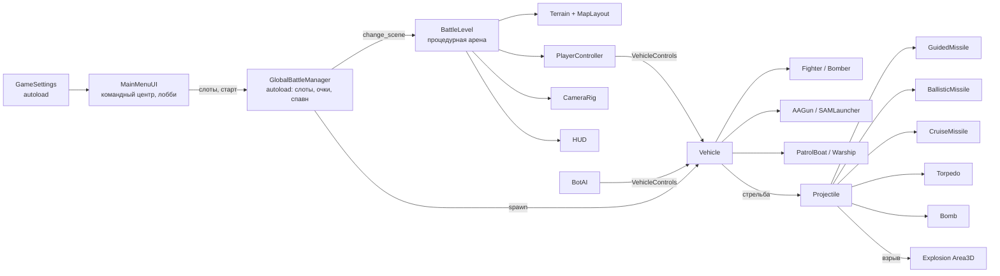

# BALLISTIK

Тактический 3D-экшен на **Godot 4.7.2** (GDScript): авиация, наземная ПВО и военный флот сражаются на одной
процедурной арене «суша — береговая линия — море». Одиночный режим: игрок и боты своей команды против команды ботов.

> Вся графика и звук генерируются **процедурно в коде**: модели собираются из `BoxMesh`, `CylinderMesh`,
> `SphereMesh`, `PrismMesh`, `TorusMesh`; рельеф, вода, небо, иконки интерфейса (SVG-разметка в коде)
> и звуковые эффекты (синтез `AudioStreamWAV`) создаются при запуске. Внешних ассетов (`.obj`, `.png`,
> `.glb`, `.wav`) нет — проект запускается сразу после клонирования.

## Возможности

- **Командный центр** — тёмный неоновый интерфейс, крупное название BALLISTIK, 3D-голограмма карты
  и сетка радара с лучом развёртки на фоне, кнопки «В БОЙ», «НАСТРОЙКИ», «ВЫХОД».
- **Лобби с лимитированными слотами** — вкладки «Авиация / Наземная ПВО / Военный Флот», карточки техники
  со счётчиками «МиГ-29 [1/2]»; если все слоты заняты — кнопка выбора заблокирована. Боты сами занимают слоты.
- **Пять классов техники** с собственной физикой и вооружением (см. таблицу ниже) и эсминцы команд —
  стратегические цели с ЗАК, которые сбивают авиацию и подлетающие ракеты.
- **Баллистика**: все снаряды — физические объекты со скоростью, квадратичным сопротивлением и гравитацией.
  Баллистическая ракета летит по параболе в указанную на карте точку (решатель подбирает начальную скорость
  с учётом сопротивления), удар создаёт зону поражения `Area3D` с повышенным уроном по зданиям и кораблям.
- **Тактическая карта** (G): метка удара, кольцо дальности, предпросмотр траектории, дистанция и подлётное время.
- **ИИ ботов**: выбор свободных слотов по потребностям команды, патрулирование, обнаружение с учётом прямой
  видимости, стрельба с упреждением, ракетные атаки, бомбометание по CCIP, торпедные атаки, уклонение с ловушками.
- **HUD**: круговой радар 3D/2D (самолёты — треугольники, корабли — квадраты, ПВО — круги, высоты на «ножках»),
  панель ХП/скорости/высоты/боезапаса/перезарядки, рамка захвата, индикатор упреждения, маркеры целей.
- **Кроссплатформенность**: Windows, Linux, Android (сенсорное управление), поддержка геймпада.

## Техника и слоты (на команду)

| Категория | Класс | Модель (СИНИЕ / КРАСНЫЕ) | Слоты | Вооружение |
|---|---|---|:-:|---|
| ✈️ Авиация | Истребитель | МиГ-29 | 2 | автопушка ГШ-30-1, 4× Р-73 (ИК ГСН), ловушки |
| ✈️ Авиация | Бомбардировщик | Су-24М | 1 | 8× ФАБ-500 (прицел CCIP), 2× Х-59 (крылатые), ловушки |
| 🛡️ Наземная ПВО | ЗСУ | Гепард | 2 | 2× 35-мм, трассеры, неконтактные снаряды, РЛС сопровождения |
| 🛡️ Наземная ПВО | ЗРК | Patriot / Бук-М1 | 1 | 4× ЗУР с разгоном и пропорциональным наведением, РЛС захвата 7 км |
| ⚓ Военный Флот | Бронекатер | Sea Baby / G-5 | 3 | пулемёт, 2× торпеды, баллистическая ракета |

Точки появления: авиация — воздушный старт над аэродромом, ПВО — береговые позиции, флот — у причала ВМБ.
Победа — по лимиту очков или по истечении времени (очки за технику, сооружения и эсминцы противника).

## Запуск

1. Установите [Godot 4.7.2](https://godotengine.org/download) (стандартная версия, не .NET).
2. Откройте `project.godot` в редакторе и нажмите **F5**, либо из командной строки:

```bash
godot --path .
```

При первом открытии редактор импортирует проект (создаст папку `.godot/`).

## Управление

**ПК (клавиатура и мышь)**

| Действие | Клавиши |
|---|---|
| Основное / дополнительное оружие | ЛКМ, Пробел / ПКМ, F |
| Тактическая карта (баллистика, Х-59) | G или СКМ |
| Ловушки · зум · режим радара 3D/2D | X · Z · T |
| Счёт · пауза · справка | Tab · Esc · F1 |
| **Авиация** | мышь — направление полёта; W/S — газ; A/D — крен; Q/E — рыскание; стрелки — ручное управление; C — камера |
| **Наземная техника и катера** | W/S — ход; A/D — поворот; мышь — обзор и прицел |
| **ЗРК** | удерживайте цель в прицеле до захвата, затем ЛКМ — пуск |
| **Тактическая карта** | ЛКМ — метка; повторный ЛКМ по метке или Enter — пуск; колесо — масштаб; WASD — сдвиг; ПКМ/G — выход |

**Геймпад**: левый стик — движение, правый — обзор, триггеры — оружие, A — карта, B — ловушки, Y — радар.

**Android**: плавающий джойстик слева, обзор перетаскиванием по правой половине экрана, кнопки оружия, газа
и ловушек; в тактическом режиме касание ставит метку, «ПУСК» — запуск. Сенсорное управление включается
автоматически на мобильных устройствах (можно принудительно включить в настройках).

## Архитектура



Техника не знает, кто ею управляет: игрок (`PlayerController`) и бот (`BotAI`) заполняют одну и ту же
структуру `VehicleControls`, а техника применяет её в своём физическом шаге.

```
res://
├── autoload/
│   ├── GlobalBattleManager.gd   # слоты по командам, участники, очки, время, спавн/респавн, реестр юнитов
│   ├── GameSettings.gd          # настройки (user://settings.cfg), карта ввода (физические клавиши, геймпад)
│   └── SoundFX.gd               # процедурный синтез звуков (AudioStreamWAV) и пул 3D-источников
├── scenes/
│   ├── MainMenu.tscn            # корень меню (Control + MainMenuUI.gd)
│   └── BattleLevel.tscn         # корень боя (Node3D + BattleLevel.gd)
├── scripts/
│   ├── core/        GameDB (данные техники и слотов), BallisticSolver, Weapon, VehicleControls, Participant
│   ├── procedural/  MeshFactory, ModelBuilder, VehicleModels, StructureModels, IconFactory
│   ├── vehicles/    Vehicle (база), Aircraft → Fighter/Bomber, GroundVehicle → AAGun/SAMLauncher, PatrolBoat, Warship
│   ├── weapons/     Projectile, GuidedMissile, BallisticMissile, CruiseMissile, Bomb, Torpedo, Explosion, Flare
│   ├── ai/          BotAI (выбор слотов и поведение ботов)
│   ├── world/       BattleLevel, Terrain, MapLayout, Building, CameraRig, PlayerController, TacticalMarker
│   ├── fx/          Effects (взрывы, дым GPUParticles3D, всплески), FallingWreck
│   └── ui/          MainMenuUI, MenuRadarScene, SlotSelector, SettingsPanel, HUD, HUDOverlay, RadarWidget, TouchControls, UITheme
├── tests/compile_check.tscn     # компиляция всех скриптов (используется в CI)
├── tools/export.ps1, export.sh  # автоматическая сборка через Godot CLI
└── export_presets.cfg           # пресеты: Windows Desktop, Linux, Android
```

## Сборка (Export) через Godot CLI

Версия шаблонов экспорта должна совпадать с версией редактора — **4.7.2.stable**.

### Требования

| Платформа | Что нужно |
|---|---|
| Windows `.exe`, Linux | Godot 4.7.2 + шаблоны экспорта 4.7.2 |
| Android `.apk` | дополнительно OpenJDK 17 и Android SDK: `platform-tools`, `build-tools;35.0.1`, `platforms;android-35` (переменные `JAVA_HOME`, `ANDROID_HOME` или пути в Editor Settings → Export → Android) |

Шаблоны экспорта ставятся в редакторе (**Editor → Manage Export Templates → Download and Install**)
или скриптом сборки с флагом установки шаблонов.

### Скрипт сборки

Windows (PowerShell):

```powershell
.\tools\export.ps1 -Godot "C:\Godot\Godot_v4.7.2-stable_win64_console.exe" -Targets windows,android -InstallTemplates
```

Linux / macOS:

```bash
GODOT=~/bin/Godot_v4.7.2-stable_linux.x86_64 ./tools/export.sh --targets "linux windows android" --install-templates
```

Параметры: платформы `windows`, `linux`, `android`; режим `release` (по умолчанию) или `debug`;
пропуск проверки скриптов. Скрипт импортирует проект, компилирует все скрипты и кладёт сборки в `build/`.

### Команды Godot CLI напрямую

```bash
godot --headless --path . --import
godot --headless --path . --export-release "Windows Desktop" build/windows/BALLISTIK.exe
godot --headless --path . --export-release "Linux" build/linux/BALLISTIK.x86_64
godot --headless --path . --export-debug "Android" build/android/BALLISTIK-debug.apk
```

### Подпись Android

Debug-APK подписывается отладочным ключом редактора автоматически. Для release-APK создайте ключ
и передайте его через переменные окружения (пароли не хранятся в репозитории):

```bash
keytool -genkeypair -v -keystore ballistik-release.keystore -alias ballistik -keyalg RSA -keysize 2048 -validity 10000
```

```bash
export GODOT_ANDROID_KEYSTORE_RELEASE_PATH=/path/to/ballistik-release.keystore
export GODOT_ANDROID_KEYSTORE_RELEASE_USER=ballistik
export GODOT_ANDROID_KEYSTORE_RELEASE_PASSWORD='пароль'
./tools/export.sh --targets android --mode release
```

### CI (GitHub Actions)

`.github/workflows/build.yml` на каждый push в `main` и pull request: скачивает Godot 4.7.2 и шаблоны,
ставит Android SDK 35 и JDK 17, компилирует все скрипты, прогоняет автотесты боя и экспортирует
Windows `.exe`, Linux и Android `.apk` (артефакты сборки доступны на странице запуска).
При пуше тега `v*` сборки публикуются в GitHub Release.

## Автотесты

```bash
# компиляция всех скриптов с загруженными autoload
godot --headless --path . res://tests/compile_check.tscn

# бой ботов 45 с без окна; в конце — статистика (попадания, пуски, перехваты, счёт)
godot --headless --path . -- --smoke-test --smoke-seconds=45

# имитация ручного управления + тактический баллистический удар с катера
godot --headless --path . -- --smoke-test --smoke-human --smoke-tactical --smoke-vehicle=boat --smoke-seconds=30

# с окном и скриншотами
godot --path . -- --smoke-test --smoke-vehicle=fighter --shots=/tmp/ballistik_shots
```

Дополнительные параметры запуска: `--touch` — включить сенсорный интерфейс на ПК, `--quality=0|1|2` — качество графики.
