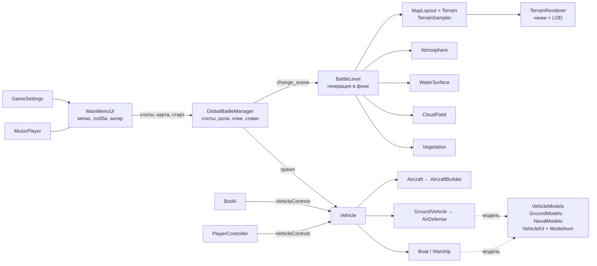

# BALLISTIK

Тактический 3D-экшен на **Godot 4.7.2** (GDScript): авиация от поршневых истребителей 1940-х до реактивных
машин, наземная ПВО и военный флот сражаются на больших процедурных картах. Режимы: тренировка с ботами
(командный бой или «каждый сам за себя»), онлайн-бой с поиском соперников и комнаты по коду для игры с друзьями.

> Графика и звуковые эффекты генерируются **процедурно в коде**: модели самолётов строит параметрический
> генератор (лофт фюзеляжа по сечениям, крылья с профилем NACA, фонари, винты, сопла), технику ПВО и корабли —
> библиотека деталей (корпуса кораблей по обводам, тела вращения, наклонная броня, гусеницы по каткам,
> колёса, антенны, расчёты), рельеф, море, небо, облака, леса, текстуры шумов, опознавательные знаки и
> бортовые номера (SVG в коде) и звуки (синтез `AudioStreamWAV`) создаются при запуске. Единственные
> внешние файлы — музыка в `sounds/`.

## Возможности

- **5 больших карт** (зона боя ~14×14 км, мир ~27×27 км, море до горизонта), у каждой свой климат,
  освещение и погода:

  | Карта | Климат и время | Особенности |
  |---|---|---|
  | Северное побережье | умеренный, утро | холмы, смешанные леса, поля, острова с маяком |
  | Тропический архипелаг | тропики, полдень | гористые острова, бирюзовые отмели, пальмы |
  | Пустынный залив | засушливый, дымка | плато и столовые горы, орошаемые поля у воды |
  | Северные фьорды | субарктика, пасмурно | заснеженные хребты, извилистые фьорды, ели |
  | Закатный пролив | средиземноморье, закат | два берега через пролив, кипарисы |

  Рельеф каждого боя уникален (зерно карты), стороны в равных условиях — шум рельефа симметричен
  относительно зеркала карты. Базы: аэродром, штаб, РЛС, позиции ПВО, ВМБ с причалом, флагманский крейсер.
- **Детальная графика**: сплаттинг рельефа (луга, лоскуты полей с межами и бороздами, леса, песок и мокрый
  пляж, скалы со слоями, снег), вода с цветом по глубине, прибоем и пеной, аналитическое небо с перистыми
  облаками, объёмные кучевые облака с тенями на земле, леса (MultiMesh, 2 уровня детализации), воздушная
  перспектива, тонмаппинг AgX, каскадные тени, SSAO; рельеф — чанки с 4 уровнями детализации.
- **19 самолётов** с детальными моделями, камуфляжем (пятна, «сплинтер», крап, натуральный металл),
  панельными линиями, опознавательными знаками-декалями, вращающимися винтами, форсажем, инверсионными
  следами:

  | Роль | Поршневые (1940-е) | Реактивные |
  |---|---|---|
  | Истребители | Bf 109 G-6, Fw 190 A-8, Як-9Т, Ла-5ФН, P-51D, P-40E, Spitfire Mk IX, A6M5 Zero | МиГ-29, Су-27, F-16C, F-4E Phantom II, Mirage 2000C, Rafale C |
  | Ударные | Ил-2, B-25J Mitchell | Су-24М, Су-25, A-10A |

  Вооружение из данных: пушки со сведением, ракеты «воздух-воздух» с ИК ГСН (у поршневых нет ловушек,
  зато захват их дольше), НАР, бомбы с прицелом CCIP, управляемые ракеты по выбранной цели и по метке
  тактической карты. Эпоха авиации боя: смешанная, поршневая или реактивная.
- **15 образцов наземной ПВО** — модели по реальным размерам: катки и гусеницы, колёсные шасси с кабинами,
  вращающиеся РЛС, пусковые с ракетами, расчёты у зениток 1940-х, камуфляж эпохи (пятна, «сплинтер»,
  пыль на ходовой):

  | Класс | 1940-е | Реактивная эра |
  |---|---|---|
  | ЗСУ | Flakpanzer IV «Wirbelwind», M16 MGMC, ЗСУ-37 | Flakpanzer Gepard, ЗСУ-23-4 «Шилка», M163 VADS |
  | Пушечно-ракетные | — | 2К22 «Тунгуска», «Панцирь-С1» |
  | ЗРК | — | Patriot PAC-2, Бук-М1, С-300ПС (вертикальный пуск), Тор-М1, AN/TWQ-1 Avenger |
  | Зенитные орудия | 8,8-cm Flak 37, 85-мм 52-К (позиции с мешками и расчётом) | — |

  Пушки ведут цель по прицелу с упреждением, ЗРК захватывают цель РЛС (радиокомандное, полуактивное,
  тепловое наведение), у вертикального пуска ракета разворачивается на цель после старта.
- **15 образцов флота** — корпуса по обводам (седловатость, развал бортов, полубак, скула и килеватость у
  глиссеров), ватерлиния, палубы, ржавые потёки, бортовые номера, флагманские крейсеры команд:

  | Класс | 1940-е | Реактивная эра |
  |---|---|---|
  | Катера | Г-5, Schnellboot S-100, PT-109 (Elco 80') | Sea Baby, Mark VI, Stridsbåt 90 (CB 90) |
  | Корабли | эсминцы Fletcher и пр. 7 «Гневный» | Arleigh Burke, пр. 956 «Современный», ракетный катер пр. 12411 «Молния» |
  | Флагманы (стратегические цели) | крейсеры «Кливленд» и «Киров» (пр. 26) | крейсеры «Тикондерога» и пр. 1164 «Слава» |

  Катера — пулемёты и автоматы в поворотных установках с секторами обстрела, торпеды, залп реактивных
  снарядов или ракета по метке тактической карты. Корабли — главный калибр по точке прицела,
  автоматическая зенитная артиллерия и ЗАК (сбивают и ракеты), ЗУР с захватом цели, торпедные аппараты,
  противокорабельные ракеты по метке. Флагман ходит сам и не занимает слот.
- **Боты мягче**: три уровня сложности («Новобранец», «Ветеран», «Ас»); боты медлят, промахиваются,
  делают паузы перед пусками ракет, реже выбирают целью игрока, их урон по игроку снижен, ЗРК ботов
  захватывают дольше. Выбрав технику, занятую ботом своей команды, игрок вытесняет его.
- **Музыка**: треки из `sounds/` — «Briefing at Midnight» в меню, «Intercept Vector» и «Target Locked in
  Salt» в бою, плавные переходы, приглушение на паузе, отдельные громкости музыки и эффектов.
- **Меню**: кинематографичный 3D-фон (звено самолётов над случайной картой), лобби с превью карт,
  выбором эпохи и 3D-просмотром техники, **ангар** со всей техникой, экран загрузки с прогрессом.
- **Кроссплатформенность**: Windows, Linux, Android и iPhone (сенсорное управление), поддержка геймпада.
  Качество графики: Низкое / Среднее / Высокое / Ультра.

Победа — по лимиту очков или по истечении времени (очки за технику, сооружения и флагман противника).

## Режимы и сетевая игра

**В БОЙ** открывает выбор режима:

| Режим | Как устроен |
|---|---|
| **Тренировка с ботами** | без сети; **командный бой** (две команды, общий счёт) или **каждый сам за себя** (все против всех, победа по личным очкам — около трети командного лимита). Карта, эпоха, сложность и размер настраиваются в лобби. |
| **Онлайн-бой** (как в War Thunder) | быстрый поиск: игра находит открытый бой с тем же режимом (команды / каждый сам за себя) и эпохой и подключается к нему; если такого нет — создаёт свой, ждёт соперников 25 с и начинает. Свободные места занимают боты, в идущий бой можно войти (игрок заменяет бота). После матча все возвращаются в лобби, и через 25 с начинается новый бой. |
| **Комнаты** | хост создаёт комнату (командную или «каждый сам за себя») и получает **код из 5 символов**; друзья вводят код и попадают в лобби. Хост выбирает карту, эпоху, сложность ботов, размер и лимиты и сам начинает бой. В поле кода можно ввести и адрес `IP[:порт]` для прямого подключения. |

Как это работает:

- **Хост — авторитет матча**: боты, урон и ХП, очки, возрождение, сооружения, флагманы. Каждый игрок сам
  симулирует свою технику и 20 раз в секунду отправляет её состояние; чужая техника на экране — «марионетки»
  с интерполяцией. Попадания своих снарядов клиент сообщает хосту (стрелок видит то, во что целился);
  снаряды повторяются у всех визуальными копиями без урона, а ракеты, бомбы и торпеды взрываются у всех там,
  где взорвался оригинал; ловушки уводят ракеты у того устройства, которое ими управляет.
- **Прямое соединение** — UDP (ENet), порт **24680** (при занятом — следующие). Хост пробует открыть порт
  на роутере через **UPnP**; в локальной сети устройства находят друг друга напрямую.
- **Каталог комнат и матчмейкинг — Firebase Realtime Database** (`scripts/net/NetDirectory.gd`, путь
  `/ballistik/v1/rooms/<КОД>`): хост публикует карточку комнаты (режим, эпоха, число игроков, адреса) и
  обновляет её каждые 10 с; карточки без обновления дольше 45 с считаются закрытыми и удаляются.
- **Резервный канал через Firebase**: если до хоста не достучаться напрямую (роутер без UPnP, мобильный
  интернет, CGNAT), клиент подключается через базу (`/ballistik/v1/relay/<КОД>`, поток Server-Sent
  Events + пакетная запись). Задержка выше (сотни миллисекунд), зато работает за любым роутером — в лобби
  такое подключение помечено «ЧЕРЕЗ СЕРВЕР».
- В сетевой игре пауза не останавливает бой; «Сменить технику» и выбор слота идут через хоста.

Рекомендуемые правила Firebase (Realtime Database → Rules), чтобы игра могла писать только в свой раздел:

```json
{
  "rules": {
    ".read": false,
    ".write": false,
    "ballistik": {
      "v1": {
        "rooms": { ".read": true, "$code": { ".write": true } },
        "relay": { "$code": { ".read": true, ".write": true } },
        "clock": { "$k": { ".write": true } }
      }
    }
  }
}
```

## Запуск

1. Установите [Godot 4.7.2](https://godotengine.org/download) (стандартная версия, не .NET).
2. Откройте `project.godot` в редакторе и нажмите **F5**, либо из командной строки:

```bash
godot --path .
```

При первом открытии редактор импортирует проект (создаст папку `.godot/`).

## Запуск на iPhone

Нужен iPhone XS / XR или новее (чип A12+) с iOS 15 и выше. Приложение для iPhone подписывается вашим
Apple ID при установке — подойдёт и бесплатный. На телефоне игра работает как на Android: альбомная
ориентация, сенсорное управление, качество графики «Низкое» по умолчанию; кнопки управления и панели боя
не заходят под вырез камеры (Dynamic Island) и полосу «Домой».

### Вариант 1: без Mac — готовый `.ipa` из GitHub Actions

1. Скачайте `BALLISTIK-unsigned.ipa`: из релиза (для тегов `v*`) либо на вкладке **Actions** → **Build
   BALLISTIK** → успешный запуск (или **Run workflow**) → артефакт **BALLISTIK-ios** (zip с `.ipa` внутри;
   нужен вход в GitHub).
2. Установите на компьютер с Windows или macOS [Sideloadly](https://sideloadly.io) (или AltStore). На Windows
   ему нужен iTunes с сайта Apple (не из Microsoft Store).
3. Подключите iPhone кабелем и подтвердите на телефоне «Доверять этому компьютеру». В Sideloadly выберите
   `.ipa`, введите Apple ID и нажмите **Start**.
4. На iPhone: **Настройки → Основные → VPN и управление устройством** → ваш Apple ID → «Доверять»; затем
   **Настройки → Конфиденциальность и безопасность → Режим разработчика** → включить (телефон перезагрузится).

С бесплатным Apple ID игра запускается 7 дней, потом её нужно установить заново тем же способом (одновременно
не больше 3 таких приложений). С платным Apple Developer Program подпись действует год.

### Вариант 2: Mac с Xcode

1. Установите Xcode 26.1 или новее (App Store), Godot 4.7.2 и шаблоны экспорта
   (**Editor → Manage Export Templates**).
2. Экспортируйте проект Xcode: в редакторе **Project → Export → iOS → Export Project** (путь
   `build/ios/BALLISTIK.ipa`) или `./tools/export.sh --targets ios`. Пресет iOS выгружает только проект
   (**Export Project Only**): `build/ios/BALLISTIK.xcodeproj`.
3. Откройте `build/ios/BALLISTIK.xcodeproj` → цель **BALLISTIK** → **Signing & Capabilities** → **Team**:
   выберите свой Apple ID (Personal Team) или добавьте его через **Add an Account…**. Если Xcode сообщит,
   что идентификатор `com.mikeliashenko.ballistik` недоступен, впишите свой Bundle Identifier.
4. Подключите iPhone, выберите его в списке устройств вверху окна Xcode и нажмите **Run** (⌘R). Доверие
   разработчику и режим разработчика на телефоне — как в шаге 4 варианта 1.

App Store Team ID в пресете — заглушка `XXXXXXXXXX`, команду выбирают в Xcode. Чтобы Godot на Mac сам
собирал `.ipa` (без **Export Project Only**) или запускал игру на iPhone кнопкой удалённого запуска,
впишите в пресет свой Team ID.

## Управление

**ПК (клавиатура и мышь)**

| Действие | Клавиши |
|---|---|
| Основное / дополнительное оружие | ЛКМ, Пробел / ПКМ, F |
| Тактическая карта (баллистика, управляемые ракеты) | G или СКМ |
| Ловушки · зум · режим радара 3D/2D | X · Z · T |
| Счёт · пауза · справка | Tab · Esc · F1 |
| **Вид от первого лица** | V — кабина самолёта (приборная доска с живыми стрелками, авиагоризонт, коллиматорный прицел или ИЛС, у реактивных — экраны), место наводчика ПВО над башней с оптическим прицелом (Z — оптика), вид с носа корабля с качкой; в кабине C — наведение мышью / прямое управление; выбор запоминается |
| **Авиация** | мышь — направление полёта; W/S — газ; A/D — крен; Q/E — рыскание; стрелки — ручное управление; C — камера |
| **Наземная техника и катера** | W/S — ход; A/D — поворот; мышь — обзор и прицел; установки сами доворачиваются на прицел |
| **ЗРК** | удерживайте цель в прицеле до захвата, затем ЛКМ — пуск (у пушечно-ракетных — ПКМ) |
| **Корабли** | ЛКМ — главный калибр; ПКМ — ЗУР по захваченной цели или торпеды; зенитки и ЗАК стреляют сами |
| **Тактическая карта** | ЛКМ — метка; повторный ЛКМ по метке или Enter — пуск; колесо — масштаб; WASD — сдвиг; ПКМ/G — выход |

**Геймпад**: левый стик — движение, правый — обзор, триггеры — оружие, A — карта, B — ловушки, Y — радар.

**Android и iPhone**: плавающий джойстик слева, обзор перетаскиванием по правой половине экрана, кнопки
оружия, газа и ловушек, «ВИД» — от первого лица; в тактическом режиме касание ставит метку, «ПУСК» — запуск.

## Архитектура



Техника не знает, кто ею управляет: игрок (`PlayerController`) и бот (`BotAI`) заполняют одну и ту же
структуру `VehicleControls`. Самолёты полностью описаны данными (`GameDB` — лётные характеристики и оружие,
`AircraftSpecs` — геометрия и окраска). Техника ПВО и флота — тоже: `GameDB` задаёт ход, живучесть и оружие
(пушки, ракеты с типом наведения, торпеды, удар по метке), а `GroundModels` / `NavalModels` собирают модель
из деталей `VehicleKit` (меши кэшируются на тип, окраска команды подменяет материал) и возвращают узлы для
механики: башни и люльки, дульные срезы, пусковые, антенны РЛС, торпедные аппараты, точки кильватерного следа.

```
res://
├── autoload/        GameSettings, SoundFX, MusicPlayer, GlobalBattleManager, Net (сетевая игра)
├── scenes/          MainMenu.tscn, BattleLevel.tscn
├── sounds/          музыка (mp3)
├── scripts/
│   ├── core/        GameDB (техника, роли, сложность), BallisticSolver, Weapon, VehicleControls, Participant
│   ├── procedural/  AircraftBuilder, AircraftSpecs, VehicleModels, GroundModels, NavalModels, VehicleKit,
│   │                ModelAsm, MeshKit, Insignia, IconFactory, TreeMeshes, StructureModels…
│   ├── vehicles/    Vehicle, Aircraft, GroundVehicle → AirDefense, Boat, Warship
│   ├── weapons/     Projectile, GuidedMissile, Rocket, BallisticMissile, CruiseMissile, Bomb, Torpedo, Explosion, Flare
│   ├── world/       MapPresets, MapLayout, Terrain, TerrainSampler, TerrainMeshBuilder, TerrainRenderer,
│   │                WaterSurface, Atmosphere, CloudField, Vegetation, MapPreview, BattleLevel, CameraRig…
│   ├── net/         NetDirectory (каталог комнат в Firebase, UPnP), FirebaseRelay, HybridPeer, RelayPeer
│   ├── fx/          Effects, ShaderLib (шейдеры), ProcTextures (процедурные текстуры), FallingWreck
│   └── ui/          MainMenuUI, MenuBackdrop, ModelViewer, SlotSelector, SettingsPanel, HUD, HUDOverlay…
├── tests/           compile_check, map_previews (миникарты и замер генерации), hangar_shots (рендер моделей)
└── tools/           export.ps1, export.sh
```

Тяжёлая генерация (сетка высот, меши чанков, расстановка леса, облака) идёт в фоновых потоках; каждый
поток рельефа использует свой `TerrainSampler` (вызовы методов общих объектов движка из разных потоков
сериализуются, чистая математика GDScript — масштабируется).

## Сборка (Export) через Godot CLI

Версия шаблонов экспорта должна совпадать с версией редактора — **4.7.2.stable**.

| Платформа | Что нужно |
|---|---|
| Windows `.exe`, Linux | Godot 4.7.2 + шаблоны экспорта 4.7.2 |
| Android `.apk` | дополнительно OpenJDK 17 и Android SDK: `platform-tools`, `build-tools;35.0.1`, `platforms;android-35` |
| iOS (проект Xcode) | шаблоны экспорта 4.7.2 на любой ОС; `.ipa` собирается только на macOS в Xcode 26.1+ (шаблоны собраны с iOS SDK 26.1) |

Windows (PowerShell):

```powershell
.\tools\export.ps1 -Godot "C:\Godot\Godot_v4.7.2-stable_win64_console.exe" -Targets windows,android -InstallTemplates
```

Linux / macOS:

```bash
GODOT=~/bin/Godot_v4.7.2-stable_linux.x86_64 ./tools/export.sh --targets "linux windows android" --install-templates
```

Команды напрямую:

```bash
godot --headless --path . --import
godot --headless --path . --export-release "Windows Desktop" build/windows/BALLISTIK.exe
godot --headless --path . --export-release "Linux" build/linux/BALLISTIK.x86_64
godot --headless --path . --export-debug "Android" build/android/BALLISTIK-debug.apk
godot --headless --path . --export-release "iOS" build/ios/BALLISTIK.ipa   # проект Xcode в build/ios/
```

Release-APK подписывается ключом из переменных `GODOT_ANDROID_KEYSTORE_RELEASE_PATH` / `_USER` / `_PASSWORD`.

### CI (GitHub Actions)

`.github/workflows/build.yml` на каждый push в `main` и pull request: скачивает Godot 4.7.2 и шаблоны,
компилирует все скрипты, прогоняет бои ботов на всех картах, тесты ручного управления авиацией, наземной
ПВО и флотом и сетевую игру (хост + клиент по UDP, командный бой и «каждый сам за себя»), экспортирует
Windows `.exe`, Linux, Android `.apk` и проект Xcode для iOS. На push в `main`, тегах и ручном запуске
(**Run workflow**) задача `ios` на macOS собирает из него `.ipa` без подписи (артефакт **BALLISTIK-ios**) —
его подписывает Sideloadly / AltStore при установке. При пуше тега `v*` сборки публикуются в GitHub Release.

## Автотесты

```bash
# компиляция всех скриптов
godot --headless --path . res://tests/compile_check.tscn

# бой ботов 45 с без окна на заданной карте (coast, archipelago, desert, fjords, strait)
godot --headless --path . -- --smoke-test --smoke-seconds=45 --smoke-map=coast

# ручное управление + удар по метке тактической карты
godot --headless --path . -- --smoke-test --smoke-human --smoke-tactical --smoke-vehicle=su25 --smoke-seconds=30

# миникарты всех карт и время генерации рельефа
godot --headless --path . --script res://tests/map_previews.gd -- --out=/tmp/maps --res=1024

# рендер моделей техники (нужно окно); --sheet — четыре ракурса на одном листе, --dist — дистанция камеры
godot --path . --script res://tests/hangar_shots.gd -- --out=/tmp/hangar --types=bf109,gepard,burke --sheet

# обход меню со скриншотами (главный экран, выбор режима, лобби комнаты, лобби «каждый сам за себя»,
# лобби с ПВО и кораблём, ангар, настройки; нужно окно)
godot --path . --resolution 1280x720 -- --smoke-test --smoke-menu --shots=/tmp/menu

# тренировка «каждый сам за себя»
godot --headless --path . -- --smoke-test --smoke-ffa --smoke-seconds=30

# сетевая игра на одном компьютере: хост (комната без публикации) и клиент по адресу
godot --headless --path . -- --smoke-test --smoke-seconds=40 --net-host[=ffa] --net-wait=8 [--net-cycle]
godot --headless --path . -- --smoke-test --smoke-seconds=35 --net-join=127.0.0.1:24680

# полный путь через каталог комнат (Firebase): первый процесс создаёт онлайн-бой, второй его находит;
# --net-relay-only — подключение только через резервный канал
godot --headless --path . -- --smoke-test --smoke-seconds=40 --net-find=teams|ffa [--net-relay-only]
```

Параметры запуска: `--smoke-vehicle=<тип>` (например `bf109`, `a10`, `tunguska`, `s300`, `burke`, `pt109`),
`--smoke-era=0|1|2`, `--shots=DIR` — скриншоты, `--touch` — сенсорный интерфейс на ПК, `--quality=0..3` —
качество графики.
